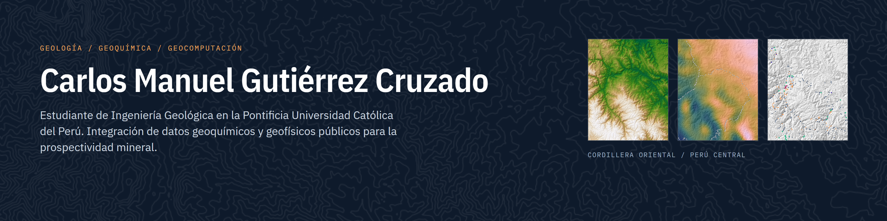

## Sobre mí

Estudiante de Ingeniería Geológica en la Pontificia Universidad Católica del Perú. Mi trabajo se centra en la
integración de datos geoquímicos, geofísicos y geológicos de acceso público para la evaluación de la prospectividad
mineral, con énfasis en el uranio y las tierras raras (U-REE) de la Cordillera Oriental del Perú central.

## Proyectos

| Proyecto | Descripción |
|---|---|
| [Prospectivity for "U - REE" - Peru Central](https://github.com/HeisenbergPy/Prospectivity-for-U-REE-Peru-Central) | Validación de fuentes públicas de gravimetría y de uranio en roca en la Cordillera Oriental de Junín y Pasco. Datos verificados con sha256, paquete de Python con pruebas automáticas y cuadernos reproducibles. Trabajo Final de Geocomputación (PUCP, 2026-II). |

## Áreas de trabajo

- Geoquímica de rocas y sedimentos: control de calidad de bases de datos públicas y diagramas petrogenéticos.
- Prospectividad mineral: variables predictoras e integración de evidencias con aprendizaje automático.
- Geofísica: comparación de la gravimetría de estaciones con modelos globales.
- Geocomputación reproducible: entornos con versiones fijas, pruebas automáticas e integridad de datos.

## Herramientas

