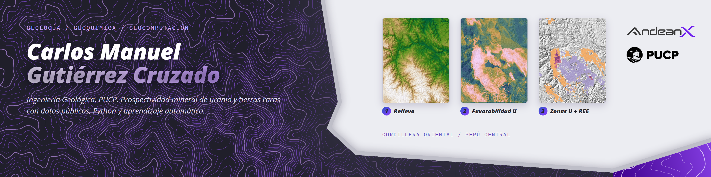

## Sobre mí

Estudiante de Ingeniería Geológica en la Pontificia Universidad Católica del Perú. Trabajo en la integración de datos
geoquímicos, geofísicos y geológicos de acceso público para la evaluación de la prospectividad mineral, con énfasis en
el uranio y las tierras raras (U-REE) de la Cordillera Oriental del Perú central.

## Proyectos

| Proyecto | Descripción |
|---|---|
| [Prospectivity for "U - REE" - Peru Central](https://github.com/HeisenbergPy/Prospectivity-for-U-REE-Peru-Central) | Validación de fuentes públicas de gravimetría y de uranio en roca, 40 variables en una grilla de 250 m y cinco modelos de aprendizaje automático validados por bloques espaciales, con 73 km² prioritarios para uranio y tierras raras en Junín. [Mapa interactivo](https://heisenbergpy.github.io/Prospectivity-for-U-REE-Peru-Central/) y [cuaderno en Colab](https://colab.research.google.com/github/HeisenbergPy/Prospectivity-for-U-REE-Peru-Central/blob/main/cuadernos/GC04_modelo_prospectividad.ipynb). Trabajo Final de Geocomputación (PUCP, 2026-II). |

## Áreas de trabajo

- Prospectividad mineral: variables predictoras, modelos de aprendizaje automático, consenso entre algoritmos y
  validación espacial (bloques, franja de prueba y pruebas contra el azar espacial).
- Geoquímica de rocas y sedimentos: control de calidad de bases de datos públicas y diagramas petrogenéticos.

## Herramientas

